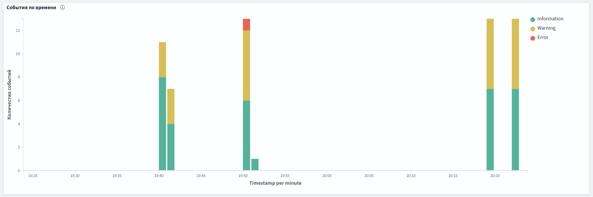
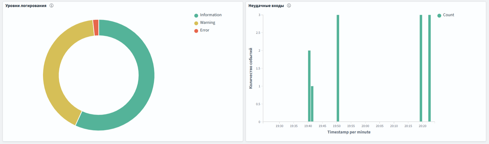

# Домашние задания по .NET

## ДЗ №2 — рефакторинг API и PostgreSQL

Продолжение регистрации пользователей из `hw2_auth/`. Существующие маршруты
сохранены. Контроллеры принимают запросы и формируют HTTP-ответы; `UserService`
хеширует и проверяет пароли, а `Data/UserRepository` выполняет запросы к БД.
Запросы к PostgreSQL асинхронные и используют параметры.

Хранение пользователей в PostgreSQL выбрано как способ продемонстрировать
реальное подключение к БД. Это решение реализации, а не отдельное требование
преподавателя о переносе всех данных. Консольное приложение первого ДЗ сохранено
и по-прежнему работает со своим списком в памяти.

### Запуск

Нужны .NET SDK для `net10.0`, установленный и запущенный Docker Desktop
с Linux-контейнерами. При первой сборке нужен доступ к NuGet.
Все команды выполняются из корня репозитория.

```powershell
dotnet build hw2_auth/UserRegistration.Api/UserRegistration.Api.csproj
dotnet build hw2_auth/UserRegistration.Console/UserRegistration.Console.csproj
```

Исходный файл решения сохранён; команды выше собирают проекты напрямую.

```powershell
.\Start-Postgres.ps1
.\Start-Api.ps1
```

Первый скрипт создаёт случайный пароль в `local/postgres_password.txt`
и запускает PostgreSQL 17 через `compose.yaml`. Пароль передаётся контейнеру
через Compose secret; `local/` уже исключён из Git. Второй скрипт читает этот
файл, задаёт `ConnectionStrings__Users` только на время запуска и поднимает API
на `http://localhost:5147`. Пароль и строка соединения не выводятся.

PostgreSQL доступен только на `127.0.0.1:5433`, данные находятся в Docker volume.
Если порт занят, используйте, например, `Start-Postgres.ps1 -Port 5434`
и `Start-Api.ps1 -DatabasePort 5434`. Порт API меняется параметром `-ApiPort`.
Таблица `app_users` и уникальный индекс логина создаются при старте API.
Скрипт инициализации не удаляет существующие данные.

Альтернатива скрипту API — задать свою строку соединения через переменную
`ConnectionStrings__Users` либо `ConnectionStrings:Users` в .NET user secrets,
после чего выполнить:

```powershell
dotnet run --project hw2_auth/UserRegistration.Api --no-launch-profile -- --urls http://localhost:5147
```

Для Swagger задайте `$env:ASPNETCORE_ENVIRONMENT = 'Development'` перед запуском
API и откройте `http://localhost:5147/swagger`.

Остановка API — `Ctrl+C`. Команда `docker compose stop postgres` останавливает
БД, сохраняя volume и пользователей. Сохраните локальный файл пароля для
последующих запусков с тем же volume: изменение файла само по себе не меняет
пароль уже созданной базы.

### Контракт API

Логин и пароль обязательны. Логин, имя и фамилия ограничены 100 символами
и не допускают управляющих символов; пароль — 1024 символами.
Имя и фамилия необязательны и могут быть пустыми, но не `null`.
Крайние пробелы логина и имени/фамилии удаляются, пароль проверяется без изменений.
Логины уникальны без учёта регистра; уникальность проверяется также самой БД.

| Запрос | Успех | Ошибки |
| --- | --- | --- |
| `POST /api/users` | `201`, пользователь и `Location` | `400` — невалидные поля; `409` — повторный логин |
| `POST /api/auth/login` | `200`, пользователь | `400` — невалидные поля; `401` — неверный логин/пароль |
| `GET /api/users/{id}` | `200`, пользователь | `400` — неположительный ID; `404` — пользователь отсутствует |
| `GET /api/users` | `200`, JSON-массив | `400` — некорректный фильтр |
| `PUT /api/users/{id}` | `204` | `400` — невалидные поля/ID; `404` — пользователь отсутствует |
| `DELETE /api/users/{id}` | `204` | `400` — неположительный ID; `404` — пользователь отсутствует |

`PUT` заменяет имя и фамилию. Запрос с текстовым ID не совпадает с маршрутом
`{id:int}` и получает `404`. Пустые/некорректные JSON-тела получают `400`.
При недоступной БД запрос получает `500` с общим ProblemDetails без деталей
подключения. Если БД недоступна при запуске, API не начинает слушать порт.

Публичные поля пользователя: `id`, `login`, `firstName`, `lastName`,
`createdDate`, `updatedDate`. Пароли и хеши не возвращаются ни в одном ответе.
В БД сохраняется только результат `PasswordHasher<User>`.

### Фильтрация по времени

```http
GET /api/users
GET /api/users?dateField=createdDate&from=2026-10-01T00:00:00Z&to=2026-10-31T23:59:59Z
GET /api/users?dateField=updatedDate&from=2026-10-01T00:00:00Z
```

- `dateField` выбирает `createdDate` (по умолчанию) или `updatedDate`, без учёта регистра.
- `from` и `to` необязательны. Границы включены: `from <= дата <= to`.
  Если передана только одна граница, проверяется только она.
- Без обеих границ возвращаются все пользователи, даже при `dateField=updatedDate`.
- Если фильтр по `updatedDate` содержит хотя бы одну границу, пользователи
  с `updatedDate = null` не попадают в результат.
- `createdDate` устанавливается при регистрации, `updatedDate` — при каждом
  редактировании. До первого редактирования `updatedDate` равен `null`.
- Время ответа и хранения — UTC. Передавайте ISO 8601 с `Z` или явным смещением;
  знак `+` в query string нужно кодировать как `%2B`. Смещения приводятся к UTC.
  Точность хранения PostgreSQL — микросекунды.
- Неизвестное поле даты, нераспознаваемые даты и `from > to` дают `400`.
  Отсутствие совпадений даёт `200` и `[]`.

### Ручная проверка

Примеры находятся в
[UserRegistration.Api.http](hw2_auth/UserRegistration.Api/UserRegistration.Api.http).
Подставьте свой придуманный тестовый пароль и ID из ответа регистрации;
подставленные пароли не должны попадать в коммит.

1. Создайте пользователя (`201`), повторите логин в другом регистре (`409`),
   проверьте пустые обязательные поля (`400`). Сверьте вход с правильным (`200`)
   и неправильным (`401`) паролем.
2. Получите список и пользователя по ID (`200`): `createdDate` заполнен,
   `updatedDate` равен `null`, паролей/хешей нет. Подставьте `createdDate`
   одновременно в `from` и `to`: пользователь должен попасть в результат.
3. Измените профиль (`204`), снова прочитайте пользователя. `createdDate`
   не меняется, `updatedDate` заполнен. Повторите фильтр с этим значением
   для `dateField=updatedDate`; затем проверьте обратный интервал (`400`).
4. Перезапустите API и БД: профиль должен сохраниться. Удалите пользователя
   (`204`), повторите чтение/удаление (`404`) и вход (`401`).

Проверить соединение и увидеть профиль непосредственно в БД без вывода хешей:

```powershell
docker compose ps
docker compose exec -T postgres psql -U user_registration -d user_registration -c "SELECT id, login, first_name, last_name, created_date, updated_date FROM app_users ORDER BY id;"
```

Корневой `.gitignore` уже покрывает сборочные файлы, JetBrains, логи,
переменные окружения и `local/`; дополнительный файл исключений не понадобился.

Подключение построено на [NpgsqlDataSource](https://www.npgsql.org/doc/basic-usage.html).
Использованы [правила времени Npgsql](https://www.npgsql.org/doc/types/datetime.html)
и [секреты Docker Compose](https://docs.docker.com/compose/how-tos/use-secrets/).

## ДЗ №3 — логирование

К существующим операциям API добавлено структурированное логирование через
`ILogger<T>`. Вывод — одна JSON-запись на строку в консоли, с временем UTC,
уровнем, категорией, `EventId`, сообщением и полями `State`.
Для запуска используются те же `Start-Postgres.ps1` и `Start-Api.ps1`.
События консольного приложения первого ДЗ в эту работу не включены.

| Уровень | EventId | Событие |
| --- | --- | --- |
| Information | 1001 | Пользователь создан |
| Information | 1002 | Успешный вход |
| Information | 1003 | Профиль изменён |
| Information | 1004 | Пользователь удалён |
| Information | 1005 | Получен список пользователей, указан `UserCount` |
| Information | 1006 | Подключение к PostgreSQL готово |
| Warning | 2001 | Регистрация с занятым логином |
| Warning | 2002 | Неудачный вход |
| Warning | 2003 | Пользователь не найден при чтении, изменении или удалении |
| Warning | 2004 | Запрос не прошёл валидацию |
| Error | 3001 | Неожиданная ошибка при обработке запроса |
| Error | 3002 | Ошибка подключения или конфигурации при запуске API |

Значения `UserId`, `UserCount`, `Operation`, `ErrorCount`, `ExceptionType`
и `TraceId` записываются отдельными полями состояния, а не склеиваются в строку.
Для неуспешного входа используется одинаковое предупреждение независимо от того,
не найден логин или неверен пароль. Ошибки валидации сохраняют стандартный ответ
`400`; дубликат — `409`, неправильный вход — `401`, отсутствие пользователя — `404`.

При неожиданном сбое `ApiExceptionHandler` записывает один `Error` и возвращает
JSON ProblemDetails со статусом `500`. `traceId` в ответе совпадает с `TraceId`
в логе. В .NET 10 обработанное исключение не дублируется штатным middleware.
При ошибке запуска API завершается с ненулевым кодом и не открывает HTTP-порт.

В предметные логи не передаются логины, имена, пароли, хеши, строка соединения
и тела запросов. Для ошибки сохраняются её тип и идентификатор запроса;
текст исключения и стек не записываются, поскольку могут содержать секреты.
Используется только консольный провайдер, поэтому запись не требует прав
на системный журнал Windows.

Примеры сообщений из проверки (JSON-оболочка опущена):

```text
Information [1001] Создан пользователь 50.
Warning     [2001] Регистрация отклонена: логин уже занят.
Error       [3001] Не удалось обработать запрос. Тип ошибки: PostgresException. TraceId: 00-9c64bb78811fc514f7c72a942dbffb44-e5878208c4a3066c-00.
```

### Уровни и ручная проверка логирования

Уровень настраивается в `UserRegistration.Api/appsettings.json`, секция
`Logging:LogLevel`. По умолчанию включён `Information`, для категорий
`Microsoft.AspNetCore` — `Warning`. Для проверки своих событий можно временно
переопределить порог перед запуском:

```powershell
$env:Logging__LogLevel__Default = 'Warning'
.\Start-Api.ps1
```

После остановки сбросьте переопределение:
`Remove-Item Env:Logging__LogLevel__Default`.
Порог `Warning` скрывает `Information`, порог `Error` скрывает также
предметные предупреждения. Более конкретная настройка категории имеет приоритет
над `Default`. Формат и время задаются в `Logging:Console:FormatterOptions`.

1. Запустите API с настройками по умолчанию. Выполните регистрацию, вход,
   редактирование, чтение списка и удаление из HTTP-примеров выше.
   Ожидаются `Information` с EventId 1001–1005 и соответствующим ID/числом записей.
2. Повторите регистрацию с тем же логином, войдите с неверным паролем,
   запросите несуществующий ID, отправьте пустой логин или неверную дату.
   Ожидаются `Warning` 2001–2004; паролей и входных значений в логах нет.
3. Пока API работает, в другом окне выполните `docker compose stop postgres`
   и `GET /api/users`. Ожидается `500` и один `Error` 3001. Сравните `traceId`
   ответа с логом. Затем обязательно запустите БД: `docker compose up -d --wait postgres`.
4. Перезапустите API с порогом `Warning` и повторите успешную операцию и отказ:
   останутся предупреждения. С порогом `Error` они тоже будут скрыты.
   Ошибку запуска 3002 можно проверить, указав заведомо неиспользуемый порт БД,
   например `Start-Api.ps1 -DatabasePort 65432`; после проверки верните порт 5433.

Настройка соответствует [JSON-форматированию логов .NET](https://learn.microsoft.com/en-us/dotnet/core/extensions/logging/console-log-formatter)
и [обработчикам исключений ASP.NET Core](https://learn.microsoft.com/en-us/aspnet/core/fundamentals/error-handling?view=aspnetcore-10.0).

## Бонус — графики в OpenSearch Dashboards

Цепочка доставки: `API → local/logs/api.jsonl → Fluent Bit → OpenSearch → Dashboards`.
`Start-Api.ps1` выводит сообщения в консоль и дописывает корректные JSON-записи
в UTF-8-файл. Сообщения сборки в этот файл не попадают. Каталог `local/`
исключён из Git. Fluent Bit читает новые строки и автоматически отправляет их
в индекс `user-registration-logs`; позиция чтения и очередь хранятся в volume.

В профиль Compose `observability` входят OpenSearch 3.9.0, Dashboards той же
версии и Fluent Bit 5.1.4. Обычный запуск PostgreSQL не запускает эти сервисы.
Для Docker рекомендуется не менее 4 ГБ памяти; для работы вместе с PostgreSQL
и другими контейнерами требуется дополнительный запас.
Это локальный учебный стенд без авторизации: порты 9200 и 5601 опубликованы
только на `127.0.0.1`.

### Запуск и демонстрация

Из корня репозитория:

```powershell
.\Start-Postgres.ps1
.\Start-Observability.ps1
.\Start-Api.ps1
```

Первый запуск загружает крупные образы. `Start-Observability.ps1` ожидает
готовности сервисов, создаёт шаблон индекса, подключает поле `Timestamp`
как дату, загружает три визуализации и общий дашборд, затем запускает доставку.
Повторный запуск обновляет эти учебные визуализации с сохранением самих логов.

Откройте [дашборд регистрации пользователей](http://localhost:5601/app/dashboards#/view/users-api-dashboard).
На нём расположены:

- количество событий по времени с разбивкой по уровням;
- распределение `Information`, `Warning`, `Error`;
- количество неудачных входов по времени (`EventId = 2002`).

Скриншоты результатов демонстрации:





В другом окне PowerShell запустите:

```powershell
.\Demo-Logs.ps1
```

Скрипт создаёт временного пользователя, выполняет успешные операции,
дубликат регистрации, три неудачных входа и невалидный запрос, затем удаляет
пользователя. Тестовый пароль генерируется в памяти и не выводится.
События остаются в журнале для графиков. Обновление дашборда — каждые 5 секунд,
интервал по умолчанию — последний час; его можно изменить вверху страницы.

Чтобы дополнительно показать `Error` 3001, можно выполнить:

```powershell
.\Demo-Logs.ps1 -IncludeDatabaseError
```

Этот вариант кратко останавливает только PostgreSQL данного ДЗ, запрашивает
список пользователей и запускает БД обратно в блоке `finally`.

### Проверка и остановка

```powershell
docker compose --profile observability ps
docker compose logs --tail 30 fluent-bit
Invoke-RestMethod http://localhost:9200/user-registration-logs/_count
```

Число документов увеличивается после новых операций API. В Dashboards → Discover
можно посмотреть отдельные сообщения и фильтровать по `LogLevel`, `EventId`,
`State.UserId`, `State.TraceId`. Описания визуализаций сохранены в
`observability/dashboards.ndjson`, схема индекса — в `observability/index-template.json`.

Для остановки API нажмите `Ctrl+C`, для остановки сервисов бонуса:

```powershell
docker compose --profile observability stop fluent-bit dashboards opensearch
```

Volumes сохраняют индекс, настройки дашборда и состояние доставки.
Скрипт запуска можно выполнить снова. Использованы
[официальные Docker-образы OpenSearch](https://docs.opensearch.org/latest/install-and-configure/install-opensearch/docker/)
и [вывод Fluent Bit в OpenSearch](https://docs.fluentbit.io/manual/data-pipeline/outputs/opensearch).
